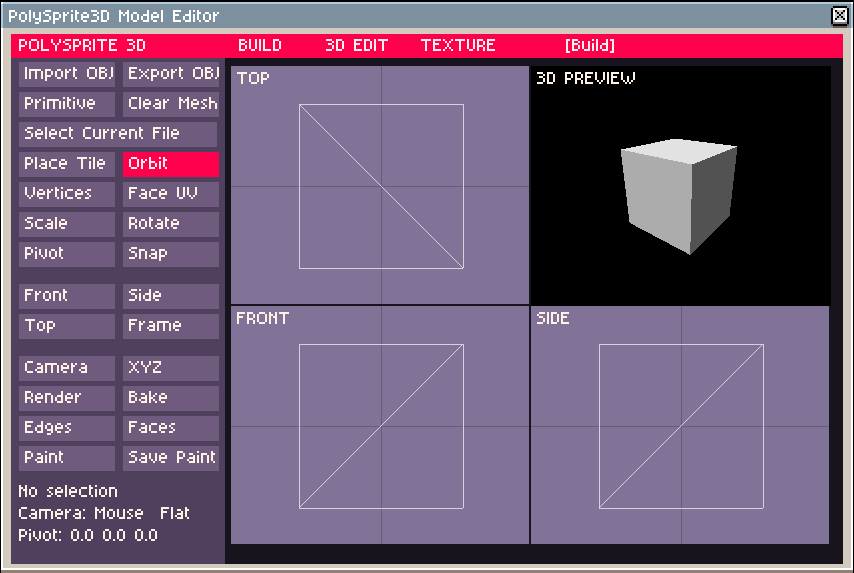
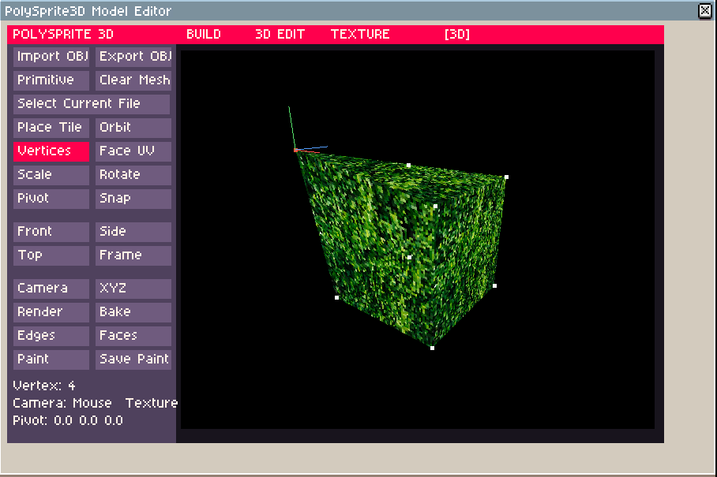
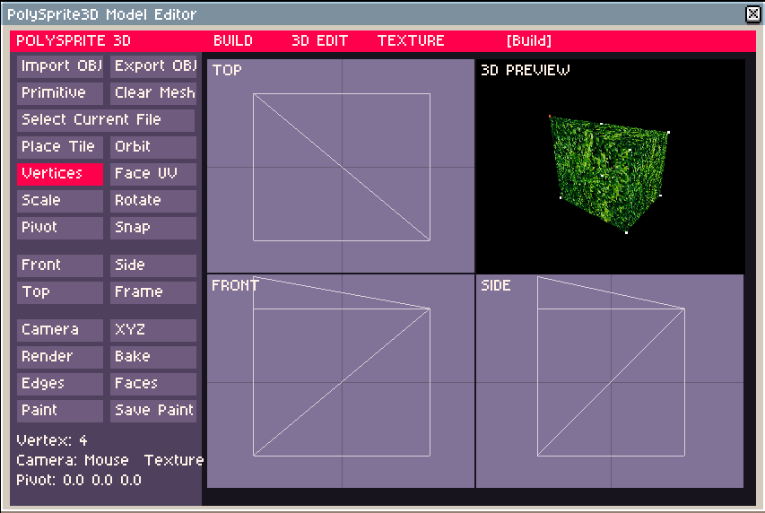

# PolySprite3D

An experimental floating 3D model editor and texture baker for Aseprite 1.3+. The editor places its tools on the left and the model views on the right. Its layout and color palette are inspired by picoCAD.

## Screenshots

## Install

**[Download PolySprite3D for Aseprite](https://github.com/AdysonReales/PolySprite3D/raw/refs/heads/main/polysprite3d.aseprite-extension)**

Download the extension above, then install `polysprite3d.aseprite-extension` with **Edit > Preferences > Extensions > Add Extension**, then restart Aseprite and open **File > Scripts > PolySprite3D**. Disable or remove any old version first. To build the package, zip `package.json`, `main.lua` and the `src` folder at the root of the archive and rename it with the `.aseprite-extension` suffix.

## Views

Use the **BUILD**, **3D EDIT**, and **TEXTURE** tabs in the red bar. Build displays top, front, and side wireframes beside a 3D preview. Click a pane to open that view in 3D Edit. The wireframes are overviews; direct editing takes place in 3D Edit. Texture shows the model preview above the loaded sprite sheet; drag on the sheet to select a rectangle, then click **Place Tile** to return to 3D Edit.

## Model editor

Choose **Import OBJ** to browse for a model file, or **Primitive**. To build a model from scratch, use **Clear Mesh**. Imported models are framed automatically; **Frame** fits the current mesh again. The editor displays one mesh at a time.

- **Vertices** (V): click a white point, then drag a colored X, Y or Z axis. **XYZ** sets its exact coordinates. Hold Shift during an axis drag for 0.25-unit steps, or Ctrl/Cmd for 0.1-unit steps.
- **Scale** (S): enter X/Y/Z scale factors for the whole mesh around its pivot.
- **Rotate** (R): enter X/Y/Z angles in degrees for the whole mesh around its pivot. Rotations apply in X, Y, Z order.
- **Pivot** (P): enter the pivot's model-space coordinates. The pivot starts at the imported model's bounding-box center; it is not written to OBJ.
- **Snap** (X): click the source vertex, then the target vertex. This moves the source to the target position; it does not merge the vertices.
- **Export OBJ** saves mesh positions and face UVs. Save the texture sheet separately; OBJ export does not embed it.

If an axis points straight at the camera, use another view before dragging it. Front, Side and Top buttons change the view.

## Select and paint

Load the texture sheet using **Select Current File**. In **3D EDIT**, choose **Vertices**, **Edges**, or **Faces** and click a visible corner, edge, or triangle. Click **Paint** and drag on the model using Aseprite's foreground color. With a face selected, painting is limited to that triangle; with an edge or corner selected, painting is limited to nearby pixels on adjacent faces. Selecting empty space clears the selection and allows painting on any face. A face is one triangle, including a triangle that is part of a larger square.

Painting changes the editor's texture snapshot. Click **Save Paint** to add an undoable `PolySprite3D Paint` layer to the original texture sprite and frame; save that sprite file normally afterward. Unsaved paint blocks loading another texture or replacing the mesh. The texture sheet uses shared UVs, so faces that use the same texture pixels also show the changes. A single-pixel texture brush is used, and the selection limits where a stroke can start on the model, not which other faces share its texture pixels.

## Camera

Click **Camera** to switch profiles. In Mouse mode, middle-drag orbits, Shift + middle-drag pans, and Ctrl/Cmd + middle-drag zooms. In Trackpad mode, select Orbit and left-drag to orbit, right-drag to pan, and Shift + left-drag to zoom. The scroll wheel zooms in either mode while the pointer is over the viewport.

## Place a tile from the current Aseprite file

1. Open your sprite sheet and use Aseprite's rectangular marquee to select the pixels you want. Leave the selection empty to use the whole sprite. The editor initially uses the selection's bounding rectangle, including any unselected pixels inside it. You can also choose a region within the Texture view.
2. Open PolySprite3D and click **Select Current File**. It captures the visible composite of the active frame and opens the Texture view. Re-select the active sprite and click the button again after editing the pixels.
3. Drag over the sheet in Texture view to select a region, then click **Place Tile**. In the right viewport, left-drag a rectangle to place a textured quad. A click without a drag places a default-sized quad with the selected rectangle's aspect ratio. Use **Clear Mesh** first if you want an empty workspace rather than the starting cube.
4. Orbit the camera to choose a different orientation before placing another tile. Tiles are created on a camera-facing plane passing through the framing center. Use **Vertices** to move the resulting corners. Use **Frame** if the model needs fitting in the viewport.
5. Export an OBJ to preserve the mesh and its UV coordinates. Save the original texture sprite separately. To bake the view, open an RGB output sprite and click **Bake**.

Aseprite does not hand off a drag directly from its canvas to this dialog, so selecting the rectangle and clicking **Select Current File** is the handoff. The texture is a snapshot, not a live link. A model can use one texture sheet at a time; after placing tiles, selecting a different sprite is blocked to avoid changing the existing tiles' appearance. Open another editor or export and clear the mesh to start with another sheet.

**Face UV** remains available to assign a numeric sheet rectangle to an existing triangle. **Render** changes the display mode.

## Current limitations

This is an early prototype, not a complete Blockbench or picoCAD replacement. Scale and rotation are numeric whole-mesh operations; there are no transform gizmos for those operations, multi-selection, mesh construction, configurable keymaps, or visual UV editor. Tile placement is a basic camera-facing plane, not the full Crocotile3D tile and grid system. Mesh and texture edits inside the editor do not yet have undo, and the pivot is not persisted in OBJ; export regularly. OBJ materials and textures are not embedded. Texture sampling clamps to the sheet edges. Opaque overlapping triangles use a depth buffer. Wireframe lines do not use depth testing, semi-transparent overlapping surfaces are not composited correctly, and near-plane clipping is not implemented. Large meshes and large bakes may be slow. Baking supports RGB sprites only.

## Development

Math, mesh, editor and rasterizer modules have no Aseprite dependencies. Run `lua tests/run_tests.lua` and `lua tests/ui_smoke.lua` from the repository root with Lua 5.4. The smoke test uses mocked Aseprite APIs; it does not replace testing in Aseprite. The extension itself requires no external libraries.

## License

MIT. See [LICENSE](LICENSE).
